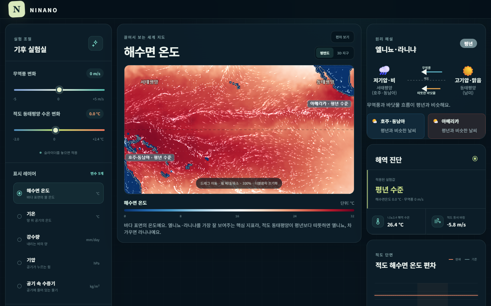
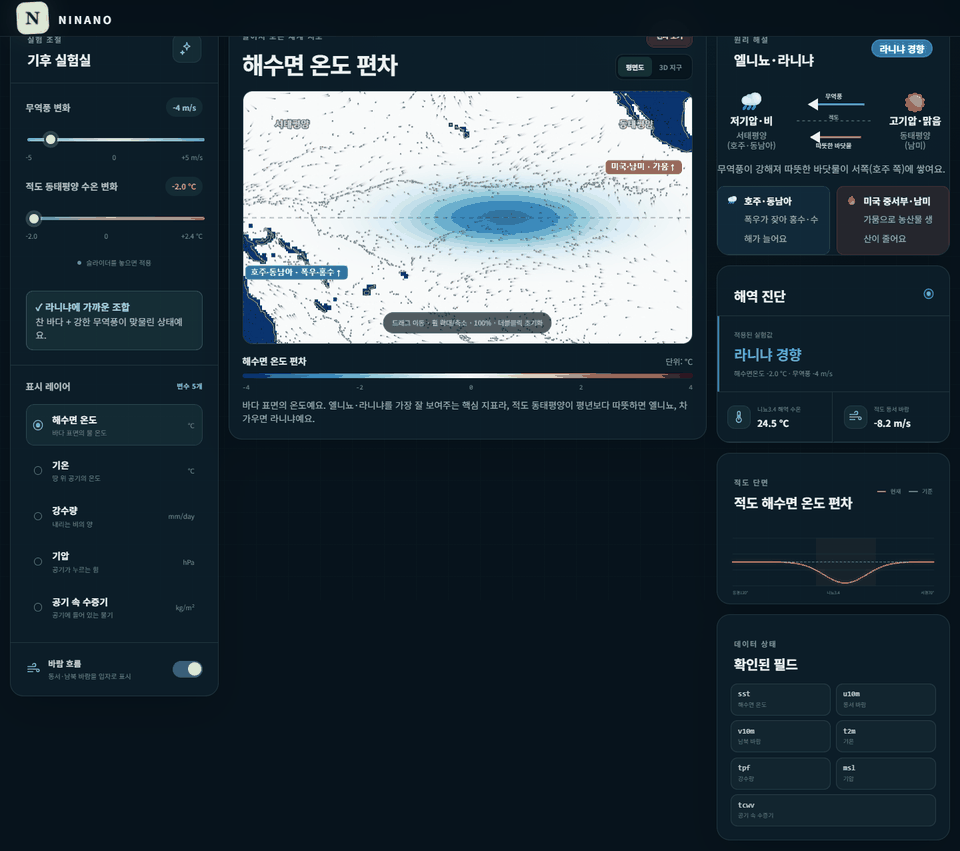
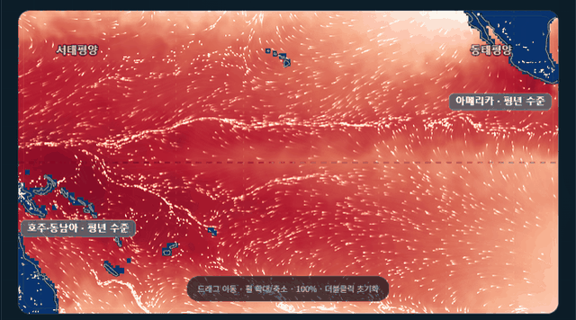
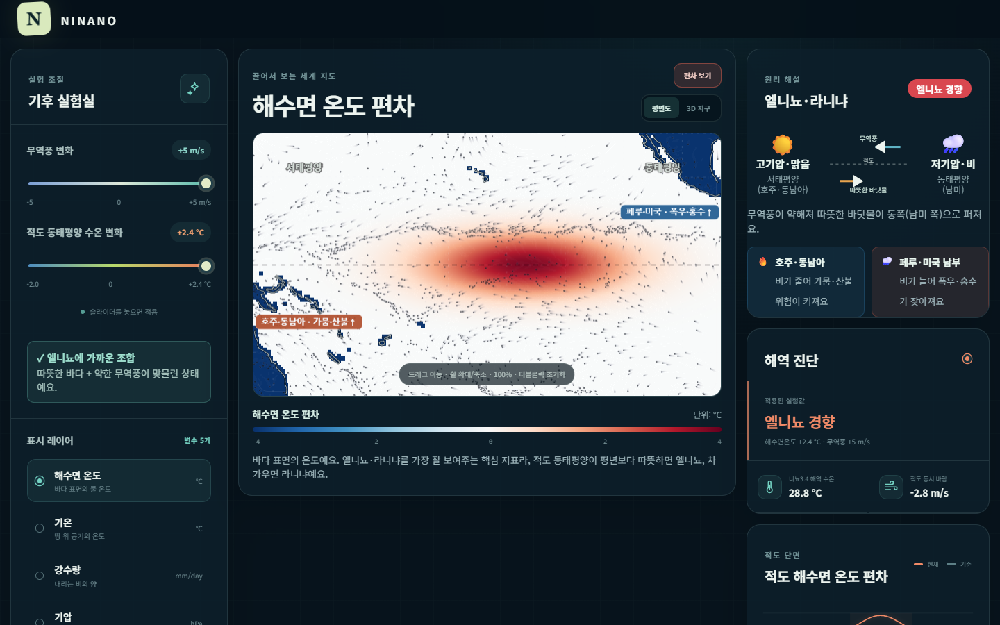
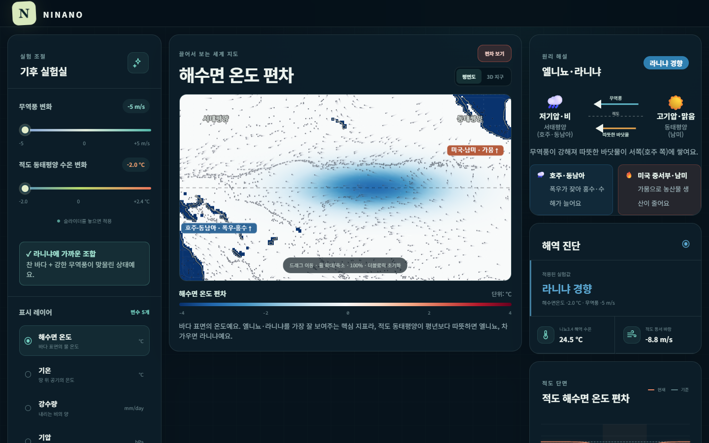
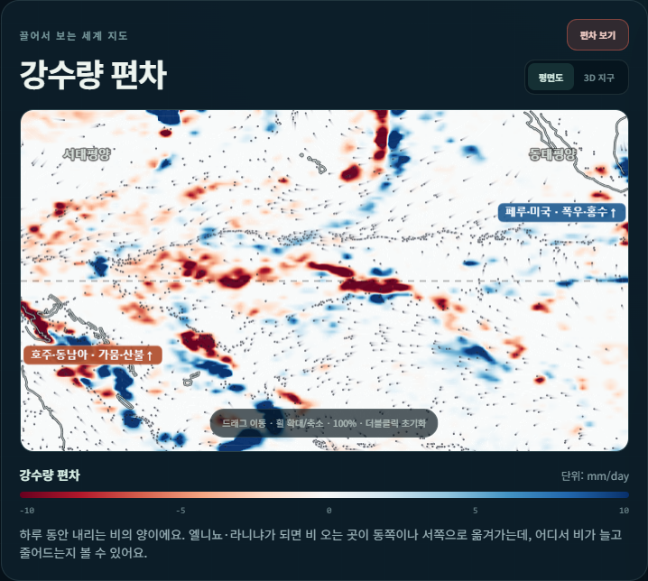
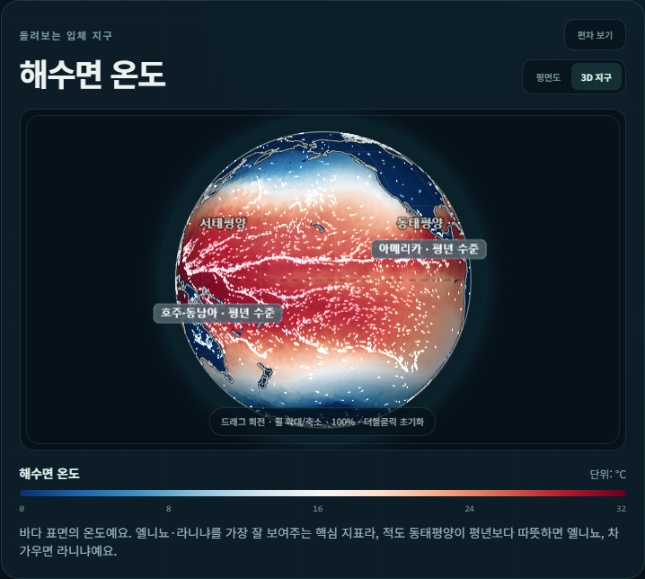

# NINANO · 엘니냐와 라니뇨

> 적도 태평양 바닷물 온도와 무역풍을 슬라이더로 바꾸면, AI 기후 모델이 만든 지구의 반응을 지도 위에서 바로 볼 수 있는 엘니뇨·라니냐 실험실

NVIDIA Earth-2의 생성형 기후 모델 **cBottle**로 "바다가 이만큼 데워지고 무역풍이 이만큼 바뀌면 지구 날씨는 어떻게 달라질까?"라는 질문의 답을 253가지 조건으로 미리 만들어 두었습니다. 웹에서는 그 결과를 평면 지도와 3D 지구 위에 WebGL로 그립니다.



- 🎬 발표 영상: [[JDC 해커톤] 엘리냐와 라니뇨](https://www.youtube.com/watch?v=tZYHsdUNgAM)
- 🏁 행사: [제2회 JDC 해커톤/게임잼](https://www.latpeed.com/products/FqsvK) (해커톤 트랙)

---

## 시연

### 슬라이더로 엘니뇨 ↔ 라니냐 오가기

적도 동태평양 수온을 `-2.0 °C`에서 `+2.4 °C`까지 올리면서 평년 대비 편차를 본 모습입니다. 오른쪽 패널의 ENSO 판정(라니냐 경향 → 평년 → 엘니뇨 경향)과 해역 진단 수치도 함께 바뀝니다.



### 바람 입자 애니메이션

cBottle이 만든 10 m 바람(`u10m`, `v10m`)을 GPU 입자로 흘려 보냅니다. 적도를 따라 동쪽에서 서쪽으로 부는 무역풍이 보입니다.



### 엘니뇨 vs 라니냐

| 엘니뇨에 가까운 조합 (`+2.4 °C`, 무역풍 `+5 m/s`) | 라니냐에 가까운 조합 (`-2.0 °C`, 무역풍 `-5 m/s`) |
| --- | --- |
|  |  |

무역풍 값은 동서 바람(`u10m`)에 더한 변화량입니다. 무역풍은 동쪽에서 서쪽으로 불기 때문에 `+`는 무역풍이 약해지는 쪽(엘니뇨), `-`는 강해지는 쪽(라니냐)입니다.

### 다른 변수와 3D 지구

| 엘니뇨 조합의 강수량 편차 | 3D 지구 보기 |
| --- | --- |
|  |  |

적도 동태평양에만 수온·바람 변화를 넣었는데도, 모델이 계산한 강수량은 태평양 곳곳에서 함께 달라집니다. 이런 원격 영향(teleconnection)을 눈으로 확인하는 것이 이 프로젝트의 목표였습니다.

---

## 해커톤

| 항목 | 내용 |
| --- | --- |
| 행사 | 제2회 JDC 해커톤/게임잼 (JDC Hackathon & Game Jam) |
| 주최·운영 | Jungle Dev Club (JDC) |
| 일정 | 2026년 6월 20일(토) ~ 21일(일), 1박 2일 |
| 장소 | 크래프톤 정글 용인 캠퍼스 (오프라인 합숙) |
| 트랙 | 해커톤 트랙: 웹·앱·AI 등 개발 중심 프로젝트 |
| 참가 대상 | SW사관학교 정글·크래프톤 정글·게임랩·게임테크랩 수료생과 JDC 알럼나이·멘토 |
| 진행 | DAY 1 오리엔테이션 후 개발 → DAY 2 발표 준비, 데모데이(발표) |
| 발표 | [[JDC 해커톤] 엘리냐와 라니뇨](https://www.youtube.com/watch?v=tZYHsdUNgAM) (Jungle Dev Club 채널) |

주제가 정해지지 않은 자유 주제 해커톤이었고, 우리 팀은 **AI 기후 모델로 엘니뇨·라니냐를 직접 만들어 보는 웹**을 1박 2일 동안 만들어 데모데이에서 발표했습니다.

---

## cBottle로 데이터를 만든 방법

### cBottle이란

[cBottle (Climate in a Bottle)](https://github.com/NVlabs/cBottle)은 NVIDIA Earth-2가 공개한 생성형(diffusion) 기후 모델입니다. 이 프로젝트에서는 [Earth2Studio](https://github.com/NVIDIA/earth2studio)에 들어 있는 `CBottleInfill`을 썼습니다. Infill 모델은 **일부 변수만 주면 나머지 대기 변수를 물리적으로 그럴듯하게 채워 넣는** 모델입니다.

이 성질을 이용해 "해수면 온도와 바람만 바꿔서 넣으면, 기온·강수·기압·수증기는 모델이 알아서 맞춰 준다"는 실험을 설계했습니다.

### 파이프라인

해커톤 중 작성한 실험 스크립트(`cbottle_combined_slider.py`, 이전 저장소의 `hyemin` 브랜치)와 생성된 데이터의 `manifest.json`을 바탕으로 정리한 흐름입니다. 253개 조건을 일괄 생성한 스크립트는 이 저장소에 들어 있지 않습니다.

```text
 ERA5 재분석 자료 (WB2ERA5)
 기준일 2013-12-15 · ENSO 중립 시기
        │  sst, u10m, v10m
        ▼
 ① 적도 동태평양에 인위적 변화 추가
    · 영역: 5°S~5°N, 170°W~120°W (Niño 3.4 해역)
    · SST: 가우시안 가중치로 ΔSST (-2.0 ~ +2.4 °C, 0.2 °C 간격, 23단계)
    · 바람: 박스 영역 u10m에 Δu (-5 ~ +5 m/s, 1 m/s 간격, 11단계)
        │
        ▼
 ② CBottleInfill 추론 (같은 seed로 기준·변경 입력을 각각 실행)
    입력 sst, u10m, v10m → 출력 sst, u10m, v10m, t2m, tpf, msl, tcwv
        │  23 × 11 = 253개 조건
        ▼
 ③ 저장
    · baseline.nc + 조건별 difference.nc (modified = baseline + difference)
    · 웹용: 변수별 0.25° 격자 raw Float32 (sst/t2m/tpf/msl/tcwv/wind × 253)  ≈ 6.9 GB
        │
        ▼
 ④ 웹용 경량화
    · 0.25° → 0.5° stride-2 다운샘플 (보간 없음, 육지 NaN 유지)  ≈ 1.8 GB
    · wind는 [u, v] 두 성분을 한 파일에 저장 (interleaved / planar 둘 다 지원)
        │
        ▼
 ⑤ FastAPI가 조건별 파일을 그대로 전송 → React + WebGL2가 렌더링
```

### 설계하면서 고민한 점

- **같은 seed로 두 번 추론하기**: diffusion 모델은 실행할 때마다 결과가 달라집니다. 기준 입력과 변경 입력을 같은 seed로 돌려야 두 결과의 차이가 "입력을 바꾼 효과"가 됩니다. 이 차이를 지도에서 "편차 보기"로 보여 줍니다.
- **변화를 넣는 모양**: 해수면 온도는 경계가 자연스럽도록 가우시안 모양으로, 무역풍은 박스 모양으로 더했습니다. 엘니뇨 지표로 쓰는 Niño 3.4 해역(5°S~5°N, 170°W~120°W)을 중심으로 잡았습니다.
- **미리 계산해 두기**: cBottle 추론은 GPU가 필요하고 조건마다 시간이 걸립니다. 해커톤 시연에서 슬라이더가 바로 반응하도록 253개 조건을 모두 미리 계산해 파일로 두었습니다.
- **브라우저가 바로 읽는 형식**: NetCDF 대신 헤더 없는 little-endian Float32 파일로 저장했습니다. 브라우저는 받은 `ArrayBuffer`를 복사 없이 `Float32Array`로 보고 WebGL `R32F` 텍스처로 올립니다.
- **용량 줄이기**: 0.5° 격자점은 0.25° 격자점의 부분집합이라, 하나 건너 하나씩 골라내기만 해도 오차 없이 용량이 1/4이 됩니다.

### 다루는 변수

| 변수 | 의미 | 화면 단위 |
| --- | --- | --- |
| `sst` | 해수면 온도 | °C |
| `t2m` | 지표 2 m 기온 | °C |
| `tpf` | 강수량 | mm/day |
| `msl` | 평균 해면 기압 | hPa |
| `tcwv` | 대기 기둥 수증기량 | kg/m² |
| `u10m`, `v10m` | 10 m 동서·남북 바람 | m/s (바람 입자) |

---

## 웹 기능

- 무역풍 변화(`-5 ~ +5 m/s`)와 적도 동태평양 수온 변화(`-2.0 ~ +2.4 °C`) 슬라이더
- 5개 변수 색상 레이어와 평년 대비 편차 보기
- GPU 바람 입자 애니메이션 (WebGL 미지원 시 Canvas로 대체)
- 드래그·휠로 움직이는 평면 지도와 3D 지구
- 엘니뇨·라니냐 원리 해설, 지역별 날씨 영향 안내
- Niño 3.4 해역 수온, 적도 동서 바람, 적도 단면 SST 편차 진단
- 조건 변경 시 이전 요청 취소(`AbortController`)와 96 MiB LRU 캐시

## 기술 스택

| 영역 | 사용 기술 |
| --- | --- |
| 기후 모델 | NVIDIA Earth-2 cBottle (`CBottleInfill`), Earth2Studio, PyTorch, ERA5 (WeatherBench2) |
| 데이터 처리 | Python, NumPy, NetCDF, raw Float32 |
| 백엔드 | FastAPI, Uvicorn |
| 프런트엔드 | React 19, TypeScript, Vite, WebGL2, Canvas, topojson (Natural Earth 육지 경계) |

## 프로젝트 구조

```text
ninano/
├─ apps/web/              # React + WebGL 프런트엔드
│  └─ src/
│     ├─ components/      # 슬라이더, 지도, ENSO 해설·진단 패널
│     ├─ data/            # Float32 로딩, 캐시, 변수 카탈로그
│     ├─ render/          # WebGL scalar/바람 렌더러, 3D 지구 투영
│     └─ store/           # 실험값과 화면 상태
├─ backend/
│  ├─ server/app.py       # 조건별 Float32 레이어 API
│  ├─ tests/
│  └─ tools/              # 0.5° 다운샘플, wind planar 변환
├─ docs/
│  ├─ TECHNICAL.md        # 데이터 형식·캐시·렌더링·배포 세부 문서
│  └─ images/             # README 스크린샷과 GIF
└─ public_data/           # cBottle 결과 (용량 문제로 Git에 포함하지 않음)
```

## 팀

3인 팀 프로젝트입니다. 1박 2일 동안 한자리에 모여 기획, cBottle 실험, 데이터 처리, 웹 구현을 함께 진행했습니다. 한 컴퓨터에서 여러 사람의 작업을 모아 커밋한 경우가 많아, 커밋 작성자가 실제 작업 분담을 나타내지는 않습니다.

---

## 로컬에서 실행하기

### 1. 데이터 준비

`public_data/`는 약 9 GB라서 저장소에 포함하지 않았습니다. 웹 실행에는 0.5° 데이터만 있으면 됩니다.

```text
public_data/
└─ f32_packed_05deg/
   ├─ manifest.json
   ├─ sst/  t2m/  tpf/  msl/  tcwv/  wind/   # 폴더마다 253개 .f32 파일
```

데이터가 없으면 웹은 UI 확인용 가상 데이터(preview)로 동작합니다. 이 데이터는 실제 cBottle 결과가 아닙니다.

### 2. 백엔드 (선택)

```bash
cd backend
uv sync
uv run uvicorn server.app:app --reload --port 8000
```

백엔드가 없어도 Vite 개발 서버가 `public_data/f32_packed_05deg`를 직접 제공합니다.

### 3. 프런트엔드

Node.js 22가 필요합니다. Windows에서는 WSL(Ubuntu)에서 실행하는 것을 기준으로 합니다.

```bash
cd apps/web
npm install
npm run dev
```

브라우저에서 <http://localhost:5173>을 엽니다.

```bash
npm run typecheck   # 타입 검사
npm run build       # production build
```

### cBottle 추론 환경

cBottle 추론은 Linux와 NVIDIA GPU 환경을 기준으로 합니다. 저장소 루트의 `pyproject.toml`에 Python 3.13, `earth2studio`, `cbottle`, `earth2grid` 의존성이 정리되어 있습니다.

```bash
uv sync
```

데이터 형식, 요청·캐시 동작, 렌더링 방식, 배포 시 주의사항은 [docs/TECHNICAL.md](docs/TECHNICAL.md)에 정리했습니다.
